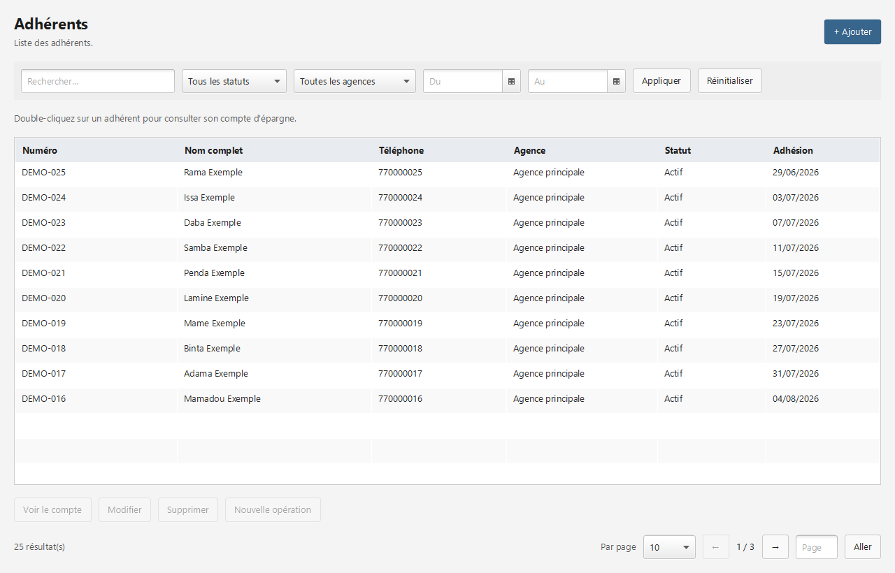
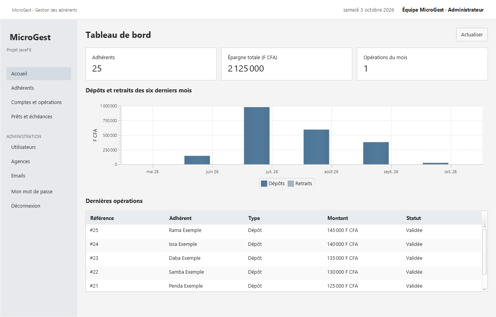

# MicroGest

## Gestion simple d’une microfinance

Présenté par : Willy Francis BOUCKA

Classe : DITI3

Établissement : ISI

Module : Développement d’applications de bureau en Java

Ce rapport présente mon projet MicroGest. Il s’agit d’une petite application JavaFX pour gérer des adhérents, leurs dépôts, leurs retraits et leurs prêts. Je me limite aux fonctions demandées dans les consignes afin de garder un projet compréhensible et facile à présenter.

## Sommaire

| Partie | Page |
| --- | --- |
| 1. Présentation et objectifs | 2 |
| 2. Utilisateurs et besoins | 3 |
| 3. Modèle de données | 4 |
| 4. Organisation du code | 5 |
| 5. Gestion des adhérents | 6 |
| 6. Comptes et opérations | 7 |
| 7. Connexion et emails | 8 |
| 8. Tableau de bord et vérifications | 9 |
| 9. Difficultés et bilan | 10 |

Le projet utilise JavaFX, FXML, CSS, Maven et Hibernate avec une base H2 locale. Les captures du rapport utilisent uniquement des données fictives.

# 1. Présentation et objectifs

## Le sujet

Le sujet proposé dans le module est la gestion d’un établissement de microfinance. L’application doit permettre de retrouver un adhérent et de suivre ses opérations courantes. Pour ce projet, je retiens l’adhésion, l’épargne et un suivi simple des prêts.

Je ne cherche pas à reproduire tout le fonctionnement d’une banque. Mon objectif est de réunir les notions du module dans une application locale : un formulaire, un tableau, des règles de validation et une base de données qui conserve les informations après fermeture.

## Les fonctions à réaliser

| Fonction | Ce que l’application doit faire |
| --- | --- |
| Connexion | Vérifier un identifiant et un mot de passe, puis appliquer les droits du rôle. |
| Adhérents | Ajouter, consulter, modifier et supprimer quand cela est possible. |
| Listes | Combiner une recherche, des filtres et une pagination en base. |
| Opérations | Enregistrer les dépôts, retraits, prêts et remboursements. |
| Emails | Jakarta Mail (anciennement JavaMail) : envoi d’emails. |
| Accueil | Afficher quelques chiffres et un graphique. |

## Les choix retenus

J’utilise H2 pour éviter l’installation d’un serveur de base de données pendant l’évaluation. Maven gère les bibliothèques. Les écrans sont décrits en FXML et les couleurs restent dans une feuille CSS séparée. Cette organisation permet de retrouver les différentes parties du projet sans multiplier les outils.

Le rapport présente le fonctionnement de l’application, son organisation et les principaux cas vérifiés.

# 2. Utilisateurs et besoins

Les consignes demandent au moins deux profils. Le projet conserve les trois rôles du sujet : administrateur, agent et superviseur. Cela permet de montrer clairement la différence entre la saisie des opérations et leur validation.

| Rôle | Actions principales |
| --- | --- |
| Administrateur | Gérer les utilisateurs et les agences. Accéder aux adhérents, aux opérations et au suivi des emails. Valider les prêts. |
| Agent | Gérer les adhérents. Saisir les dépôts, retraits, demandes de prêts et remboursements. |
| Superviseur | Consulter les données et les statistiques. Valider un prêt ou annuler une opération. |

## Exemple de parcours

Un agent se connecte, ouvre la liste des adhérents et ajoute une personne. Un compte d’épargne est créé automatiquement. L’agent peut ensuite enregistrer un dépôt ou un retrait. Pour un prêt, il saisit la demande ; un responsable doit la valider avant les remboursements.

## Les contrôles de saisie

Les champs indispensables ne peuvent pas rester vides. Le téléphone doit avoir un format accepté et ne pas être déjà utilisé. L’adresse email est vérifiée. Les montants doivent être positifs et entiers en F CFA. Une date de fin de filtre ne doit pas précéder la date de début.

En cas d’erreur, un message explique ce qui doit être corrigé. Le formulaire reste ouvert pour éviter de tout saisir à nouveau. Les droits sont aussi contrôlés dans les services : masquer un bouton ne suffit pas pour interdire une action.

# 3. Modèle de données

Le modèle repose sur l’adhérent et ses opérations. Une agence regroupe plusieurs adhérents. Chaque adhérent possède un compte d’épargne et peut avoir plusieurs opérations. Les entités sont des classes Java annotées avec JPA.

Le champ loan d’une opération relie un remboursement au prêt concerné. Le solde du compte est calculé à partir des dépôts et des retraits validés. Il n’est pas saisi manuellement.

AccountUser représente les comptes de connexion. Email contient les messages en attente ou envoyés. Une petite table Audit conserve une trace interne des modifications.

## Création de la base

Le fichier src/main/resources/db/schema.sql crée les tables et les relations. Hibernate vérifie ensuite que les entités correspondent au schéma. Les contraintes d’unicité et les clés étrangères complètent les vérifications faites en Java.

# 4. Organisation du code

J’ai retenu une organisation en couches pour séparer les écrans, les règles de gestion et les accès à la base. L’idée est simple : un contrôleur ne doit pas calculer lui-même un solde ou décider seul des droits d’un utilisateur.

| Dossier | Contenu |
| --- | --- |
| ui | Contrôleurs des vues FXML, navigation, tableaux et formulaires. |
| service | Connexion, règles de gestion, opérations et emails. |
| repository | Requêtes de recherche, filtres, comptage et pagination. |
| model | Entités JPA : Adherent, Operation, Agency et autres données. |
| config | Ouverture de la base et emplacement des fichiers. |

## Du bouton à la base

Quand l’utilisateur enregistre un adhérent, le contrôleur récupère les champs. Le service vérifie le rôle et les valeurs. La transaction enregistre les données avec Hibernate. Si tout se passe bien, le tableau est actualisé. Sinon, les modifications sont annulées et un message est affiché.

## Les vues

Le projet contient une vue de connexion, une fenêtre principale avec menu, un tableau de bord, une vue de liste commune et un dialogue de formulaire. Les champs des formulaires sont ajoutés dans la grille de ce dialogue selon les données à saisir.

Les vues sont écrites en FXML et les styles sont définis dans app.css.

## Les dépendances

Maven fournit JavaFX, Hibernate, H2 et Jakarta Mail. Le code cible Java 17 ou supérieur.

# 5. Gestion des adhérents

Le formulaire d’adhésion demande le nom, le téléphone, l’email, l’adresse, l’agence et le statut. À l’enregistrement, l’application attribue un numéro et ouvre le compte d’épargne. La liste permet ensuite de consulter ou modifier la fiche.

## Recherche, filtres et pages

La recherche accepte le nom, le numéro ou le téléphone. Elle peut être combinée avec le statut, l’agence et une période. La pagination utilise deux requêtes : une pour compter les résultats et une pour récupérer la page avec setFirstResult et setMaxResults.

L’utilisateur peut choisir le nombre de lignes, passer à la page suivante ou saisir un numéro de page. Les filtres s’appliquent au total comme aux lignes affichées.

Un adhérent sans opération peut être supprimé. Si des opérations existent, la suppression est refusée afin de ne pas perdre les mouvements. Le statut suspendu permet de bloquer les nouvelles opérations.

# 6. Comptes et opérations

## Dépôts et retraits

Le solde correspond aux dépôts validés moins les retraits validés. Les montants sont stockés avec BigDecimal pour éviter les approximations des nombres à virgule flottante. Le compte ne peut pas devenir négatif après un retrait.

| Opération | Résultat |
| --- | --- |
| Dépôt de 50 000 F CFA | Le solde devient 50 000 F CFA. |
| Retrait de 10 000 F CFA | Le solde devient 40 000 F CFA. |
| Retrait de 40 001 F CFA | La demande est refusée : solde insuffisant. |

## Le prêt

Une demande de prêt contient le capital, le taux total et l’échéance. Elle commence avec le statut EN_ATTENTE. Un administrateur ou un superviseur peut la valider. La date d’échéance doit être future au moment de cette validation.

Le calcul reste un intérêt simple : pour un capital de 100 000 F CFA à 10 %, le total à rembourser est 110 000 F CFA. Après un remboursement de 60 000 F CFA, le restant dû est 50 000 F CFA. L’application refuse un remboursement supérieur à ce restant.

## Modifier ou annuler

Une demande de prêt en attente peut être modifiée ou supprimée. Une opération validée peut être annulée par un responsable, mais reste enregistrée. L’annulation est refusée si elle rend le solde négatif. Un prêt avec des remboursements validés ne peut pas être annulé directement.

Les prêts et leurs remboursements sont séparés de l’épargne.

# 7. Connexion et emails

## Connexion

Au premier lancement, un formulaire permet de créer le compte administrateur. Le mot de passe est haché avant son stockage ; il n’apparaît jamais en clair dans la base. Le projet utilise PBKDF2 avec un sel aléatoire.

Après la connexion, le menu dépend du rôle. L’administrateur peut créer les autres utilisateurs et désactiver un compte. Chaque utilisateur peut changer son propre mot de passe. Les services vérifient le compte et le rôle à chaque action.

## Envoi des emails

Jakarta Mail (anciennement JavaMail) assure l’envoi d’emails. La création d’un adhérent prépare un message de bienvenue. Des notifications sont également prévues pour les opérations et les prêts.

| État | Signification |
| --- | --- |
| EN_ATTENTE | Le message attend son envoi ou une nouvelle tentative. |
| ENVOYE | Le message a été envoyé. |
| ECHEC | Les tentatives ont échoué ; un administrateur peut relancer. |

# 8. Tableau de bord et tests

L’accueil affiche trois indicateurs : le nombre d’adhérents, l’épargne totale et les opérations du mois. Un graphique compare les dépôts et les retraits des six derniers mois. Les dernières opérations sont listées en dessous.

## Vérifications

Les vérifications automatisées donnent 12 tests exécutés et 0 échec ou erreur. Elles portent notamment sur les accès, les doublons, la pagination, le solde, les prêts et la conservation des données après réouverture.

Un scénario charge les vues FXML, remplit le formulaire d’un adhérent puis enregistre un dépôt. Il vérifie que le solde obtenu correspond au montant saisi. Les tests utilisent une base séparée de celle de l’application.

Ces vérifications couvrent les principaux cas du projet.

# 9. Difficultés et bilan

## Les points à surveiller

Ce projet n’a pas été simple pour moi. Pour garder un travail abordable, je me suis limité aux fonctions nécessaires et à des règles de gestion faciles à expliquer. Le but reste de présenter une application qui fonctionne sur un poste, avec un code que je peux reprendre étape par étape.

La recherche et la pagination demandent une attention particulière : le total des résultats et la page affichée doivent utiliser les mêmes critères. Pour les opérations, il faut aussi éviter qu’un retrait ou une annulation rende le solde négatif. Ces deux points justifient les contrôles présents dans les services.

## Bilan

Le projet réunit les principales notions du module : JavaFX et FXML pour les écrans, Hibernate pour la persistance, et des services pour les règles de gestion. L’essentiel pour moi est de pouvoir expliquer le chemin suivi par une donnée, depuis le formulaire jusqu’à son enregistrement en base.

## Documents et références

Le dépôt Git du projet est accessible à cette adresse : github.com/Franwill01/JavaMicroGest.

Références : consignes du module ; documentation OpenJFX (openjfx.io/openjfx-docs/) ; documentation Hibernate ORM 6.6 (hibernate.org/orm/documentation/6.6/).
